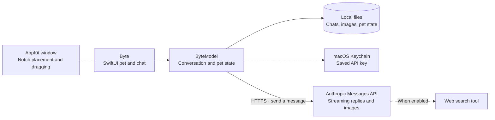

<div align="center">


**A little company. A lot of Claude. Right below your Mac's notch.**

<br>


<br><br>

[Get started](#get-started) · [Features](#features) · [Meet Byte](#meet-byte) · [Settings](#settings) · [Privacy & cost](#privacy-and-cost) · [Troubleshooting](#troubleshooting) · [Development](#development)

</div>

---

Byte is a native macOS companion with two sides: a pixel-art T-rex who needs a snack, a drink, and a little attention; and a compact Claude chat panel for questions, code, images, and web research. He lives just below the notch, reacts while he thinks, and remembers where you leave him.

Click to chat. Hover to care. Drag to make yourself at home.

**The pet works without an API key.** Connect your own Anthropic key when you want AI replies. Byte is built with SwiftUI and AppKit, with no third-party runtime dependencies.

> **Source preview:** Byte is currently built from source. Bundles produced by this repository are unsigned, and native macOS build, test, and runtime validation remain outstanding. See the [review and validation notes](docs/CODE_REVIEW.md#validation) for the current evidence.

<a id="features"></a>
## ✨ What you get

### 🦖 A desktop companion with a personality

- **Pixel-art T-rex** with happy, neutral, and thinking expressions, idle movement, and little tricks: stomps, rolls, wiggles, and greetings.
- **A pet care loop** with hunger, thirst, energy, and happiness. Feed him, give him water, play, or let him rest; needs and pet age persist between launches.
- **Animated care scenes** with tiny props and optional synthesized stomp sounds.
- **Optional check-ins** and adjustable puns, from off to lots.
- **A home under the notch**, or wherever you drag him. His pinned position is remembered; a right-click resets it.

### 🧠 Claude, one click away

- **Streaming replies** in a compact panel, with Markdown formatting and copyable code blocks.
- **Image questions** by dragging an image onto Byte, pasting with ⌘V, or using the clipboard button. Attach a screenshot, diagram, or photo to your next message.
- **Optional web search** with source links beneath answers, capped at five tool uses per request.
- **Model and effort controls** in Settings; changes apply to your next message.
- **Stop reply** to cancel generation or a retry. Partial text stays visible with an interruption status.
- **A session usage estimate** for reported tokens and searches.

### 📚 Conversations you can come back to

- **Persistent chat history** and locally stored image attachments.
- **New chat** archives your current thread before clearing it.
- **Saved chats** lets you browse previews, reopen a conversation, or delete an archive.
- **Prompt saving and streaming checkpoints** preserve work before a request and about once a second while replies arrive.
- **Visible storage errors**: failed archiving keeps the live conversation available, and unreadable history is preserved in a recovery copy before replacement.

### 🍎 Built for the Mac

- **SwiftUI + AppKit**, with a transparent, borderless companion window and no Dock icon.
- **macOS Keychain** for API keys entered in the app.
- **Launch at login** for an installed app bundle.
- **No notch required**: Byte falls back to the top of the main display.

<a id="get-started"></a>
## 🚀 Get started

### 1. Check your Mac

| Requirement | Details |
| --- | --- |
| Operating system | **macOS 14 Sonoma or newer** |
| Build tools | **Swift 5.9+**, supplied by Xcode or Xcode Command Line Tools |
| AI chat | An **Anthropic API key** and an internet connection |
| Pet and care | Works locally without an API key |

Check your toolchain with `swift --version`. If Apple's command-line tools are missing, run `xcode-select --install` and finish the installer before continuing.

### 2. Clone and run

```bash
git clone https://github.com/ronniekai999/byte.git
cd byte
swift run
```

Byte appears near the top of your display. **Click him to open chat.** You can use the pet first, or paste your Anthropic API key into the connection form and choose **Save**.

Create a key in the [Anthropic Console](https://console.anthropic.com/). API usage is billed to your Anthropic API account; a Claude subscription does not include API credits.

### 3. Make it an app

From the repository directory:

```bash
./bundle.sh
open Byte.app
```

The script builds the release executable and assembles `Byte.app` with its icon and macOS bundle metadata. Move the app into **Applications** for everyday use, then enable **Launch at login** in Byte's Settings if desired.

This is a locally built, **unsigned** bundle. If macOS asks for confirmation, use Finder's **Open** action and follow the system prompts. Developer ID signing and notarized distribution are on the [roadmap](#roadmap).

<details>
<summary><strong>Use an environment variable instead of saving a key</strong></summary>

An `ANTHROPIC_API_KEY` environment variable takes precedence over the key saved in Keychain. For a terminal-launched development session, enter it without putting the key in shell history:

```bash
read -r -s -p "Anthropic API key: " ANTHROPIC_API_KEY
printf '\n'
export ANTHROPIC_API_KEY
swift run
unset ANTHROPIC_API_KEY
```

These commands use **Bash**; run `bash` first if your terminal uses another shell. A Finder-launched app does not automatically inherit this terminal variable. Use the in-app key form for an installed app.

</details>

<a id="meet-byte"></a>
## 🎾 Meet Byte

| Action | What happens |
| --- | --- |
| **Click Byte** | Open or close chat |
| **Hover over Byte** | Reveal quick feed, water, and play controls |
| **Open the care panel** | See needs and pet age; feed, water, play, or rest |
| **Drag Byte** | Move him and remember the new position |
| **Type, then Return** | Send a question |
| **Drop or paste an image** | Attach it to the next question |
| **Stop reply** | Cancel an active reply or retry |
| **New chat** | Archive the current thread and start fresh |
| **Saved chats** | Browse, reopen, or delete archived conversations |
| **Right-click Byte** | Open chat, perform tricks, manage care, reset position, sign out, or quit |

A few things to try:

- “Explain the error in this screenshot.” Paste an image, then ask.
- “Find the official documentation for this API.” Enable web search for source links.
- “Help me simplify this Swift function.” Paste code and copy the suggested result.
- Give Byte some water, play a round, then let him rest.

The companion window sits **below** the physical notch cutout. Dragging Byte lets you choose a different spot on your display.

<a id="settings"></a>
## ⚙️ Make Byte yours

Open chat and choose the **gear** in its header.

| Setting | Default | What it changes |
| --- | --- | --- |
| Web search | On | Allows Claude to search the web when answering |
| Sound effects | On | Plays Byte's synthesized stomp sounds |
| Random check-ins | On | Lets Byte occasionally say hello or mention a need |
| Puns | Lots | Choose Off, Light, or Lots |
| Model | Sonnet 4.6 | Selects the model for the next request |
| Effort | High | Low, Medium, or High for supported models |
| Launch at login | Reflects macOS registration | Starts an installed Byte bundle when you sign in |

### Model choices

The current picker contains these identifiers:

| Choice | API model ID | Request behavior |
| --- | --- | --- |
| Sonnet 4.6 | `claude-sonnet-4-6` | Image input, adaptive thinking, adjustable effort |
| Opus 4.8 | `claude-opus-4-8` | Configured for image input, adaptive thinking, adjustable effort |
| Haiku 4.5 | `claude-haiku-4-5-20251001` | Image input and standard generation; effort is disabled |

Model IDs and capabilities are configured in [AnthropicRequest.swift](Sources/Byte/AnthropicRequest.swift). **Live model availability has not been verified**, and the Opus identifier was retained from the original source. If a request reports an unavailable model, choose one your Anthropic account supports. Model discovery and a shared capability/pricing catalog are planned.

<a id="privacy-and-cost"></a>
## 🔐 Your data, keys, and API costs

### What stays on your Mac

Byte stores conversations, pet state, and attachments under `~/.config/byte`:

```text
~/.config/byte/
├── history.json                 # Current conversation
├── pet.json                     # Needs, age, and pet state
├── archives/
│   └── chat-<timestamp>-<UUID>.json
├── images/
│   └── <UUID>.jpg               # Resized image attachments
└── history-recovery-<UUID>.json  # Created when unreadable history is preserved
```

Settings and pinned position use macOS preferences. Newly entered API keys use **Keychain**, separately from the conversation files. Chat and image files are local files; they are **not encrypted by Byte**. Back up the whole data directory to retain attachments alongside chats.

Older `~/.config/byte/api_key` files are migrated to Keychain. The plaintext file is removed only after the Keychain write and read succeed; a failed migration retains the original and shows an error. The older `~/.config/finn` directory is migrated when a Byte directory does not already exist.

### What goes to Anthropic

When you send a question, Byte sends the conversation context, its system prompt, and attached images in that thread to the **Anthropic Messages API**. AI replies require cloud access. With web search enabled, Claude can also use Anthropic's search tool.

Image attachment is explicit: drag, paste, or use the clipboard button. Byte does not automatically capture your screen.

### How the cost estimate works

The session meter uses reported input/output tokens and web searches, with approximate prices defined in the source. It includes known usage from failed attempts. Actual billing can differ because of cached-token pricing, disconnects, and provider price changes.

Long conversations resend more context, including images. Starting a new chat, choosing a lower-cost supported model, and turning off search when you do not need it can reduce usage. Check actual charges in your Anthropic account; the meter is an estimate.

Deleting an archive currently leaves image sidecars on disk. Automatic image cleanup, retention limits, and context summarization are planned.

<a id="troubleshooting"></a>
## 🩺 Troubleshooting

| Symptom | What to check |
| --- | --- |
| **Build tools are missing** | Run `xcode-select --install`, complete installation, and confirm `swift --version` reports 5.9+. Build on macOS 14 or newer. |
| **Byte has no Dock icon** | This is an accessory app. Look near the top of the display; right-click Byte for **Quit**. |
| **Byte is in the wrong place** | Right-click him and choose **Reset position to notch**, then drag him to your preferred spot. |
| **Chat asks for a key after I saved one** | Check the storage error banner and Keychain access. For terminal runs, check whether `ANTHROPIC_API_KEY` overrides the saved key. |
| **A model request is rejected** | Check the key's API access and the model ID in Settings. Live availability of the bundled IDs, especially Opus, needs verification. |
| **A reply stalls or is interrupted** | Use **Stop reply** and send again when connectivity recovers. Partial replies remain visible with a status and are excluded from future assistant context. |
| **New chat or reopening reports a save error** | Check available disk space and access to `~/.config/byte`. Keep the live thread and recovery files until the storage problem is resolved. |
| **Launch at login does not work** | Use an installed `Byte.app` rather than `swift run`. Check **System Settings → General → Login Items** for approval or add the app there manually. |
| **Keychain asks for access after a rebuild** | Unsigned executable changes can trigger another access prompt. Stable code signing is a distribution goal. |

For a bug report, include your macOS version, Swift version, steps to reproduce, and the visible error. Remove API keys and private chat content before sharing logs or screenshots. [Open an issue](https://github.com/ronniekai999/byte/issues).

<a id="architecture"></a>
## 🏗️ How it works



SwiftPM builds one native executable. AppKit manages the companion window; SwiftUI renders the pet, chat, settings, and archives. The model handles pet simulation, persistence, request snapshots, streamed responses, cancellation, retries, and usage accounting.

<a id="development"></a>
## 🛠️ Development

Run the native checks **on a Mac**:

```bash
swift build
swift test
./bundle.sh
plutil -lint Byte.app/Contents/Info.plist
```

The [macOS workflow](.github/workflows/ci.yml) is configured to run the same sequence. The source includes **26 regression tests** for request options, usage, persistence, archives, key migration, images, interrupted streams, cancellation, citations, and link handling. Tests use temporary directories, stubbed HTTP streams, and an in-memory key store; they do not call Anthropic or use your real Keychain.

A passing native build/test/bundle run has **not yet been established**. Linux syntax checks cannot validate AppKit, SwiftUI, Security, or AVFoundation. Read the [code review](docs/CODE_REVIEW.md) for findings, remaining priorities, and validation limits.

### Source map

| File | Responsibility |
| --- | --- |
| [App.swift](Sources/Byte/App.swift) | App lifecycle, borderless window, placement, and dragging |
| [ByteModel.swift](Sources/Byte/ByteModel.swift) | Conversation state, persistence, archives, pet care, and streaming |
| [AnthropicRequest.swift](Sources/Byte/AnthropicRequest.swift) | Model-specific request options and cumulative usage |
| [APIKeyStore.swift](Sources/Byte/APIKeyStore.swift) | Keychain storage and the testable key-store interface |
| [ByteView.swift](Sources/Byte/ByteView.swift) | Pet interaction, chat, Markdown, settings, and archives |
| [ByteSprite.swift](Sources/Byte/ByteSprite.swift) · [Props.swift](Sources/Byte/Props.swift) | Pixel-art character and care props |
| [Quips.swift](Sources/Byte/Quips.swift) · [Sound.swift](Sources/Byte/Sound.swift) | Personality and synthesized audio |
| [WebLinks.swift](Sources/Byte/WebLinks.swift) | HTTP(S)-only generated link handling |

For contributions, keep changes focused, explain the user-visible behavior, and run the relevant macOS checks. Add regression coverage for changes to persistence or streaming, where failures can lose work or corrupt context. Real Keychain prompts, live provider access, visual behavior, and monitor changes also need manual Mac checks.

<a id="roadmap"></a>
## 🌱 What's next

The next priorities are:

1. **A configurable global shortcut** to open and focus chat across apps.
2. **Context and spending controls**, with thread limits and optional summaries.
3. **Verified model discovery**, shared capabilities, and current pricing.
4. **Signed, notarized distribution** with stable Keychain identity.
5. **Image cleanup and attachment recovery**, better display positioning, a resizable panel, and reduced-motion support.

See the [full roadmap](BYTE_ROADMAP.txt) and [ranked review findings](docs/CODE_REVIEW.md#next-improvements) for scope and acceptance criteria.

---

<div align="center">

**Small arms. Big answers.**

Built for the little moments between the big ones. 🦖

</div>
